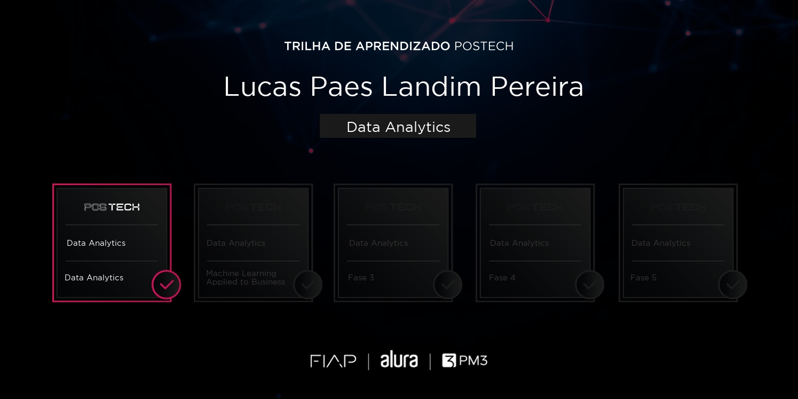
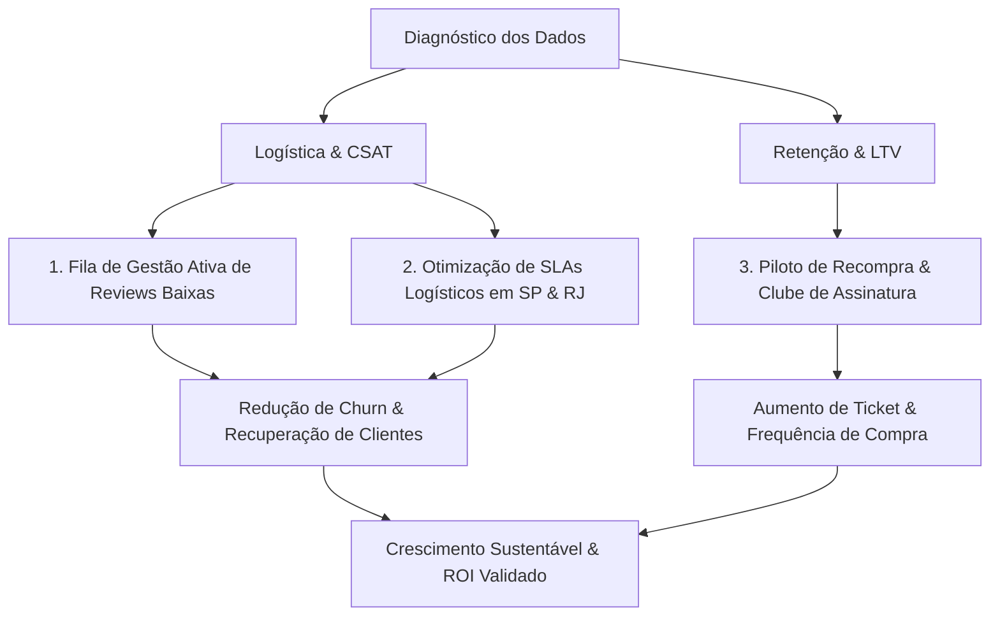

# 📊 Tech Challenge - Fase 1 | Data Analytics

<div align="center">


</div>

---

## 🎓 Certificado de Conclusão da Fase 1

<div align="center">
  
  <p><i>Certificado de conclusão da Fase 1 (Data Analytics) da Trilha de Aprendizado Pós-Tech - Lucas Paes Landim Pereira.</i></p>
</div>

---

## 📌 Contexto & Cenário de Negócio

No âmbito do **Tech Challenge da Fase 1 da Pós-Tech em Data Analytics (FIAP, Alura e PM3)**, este projeto foi desenvolvido sob a perspectiva de uma **consultoria analítica e estratégica** para o ecossistema de e-commerce da **Olist**.

O objetivo primordial foi analisar os dados históricos da operação comercial e logística entre **setembro de 2016 e agosto de 2018**, diagnosticando gargalos de satisfação e retenção, e propondo planos de ação respaldados por viabilidade econômica para apresentação a **acionistas e investidores**.

---

## 🚀 Principais Conquistas & Indicadores Operacionais

A partir do tratamento rigoroso de quase 100.000 pedidos, foram consolidados os seguintes indicadores-chave de desempenho (KPIs):

| Indicador | Resultado | Critério Analítico |
|---|---|---|
| **Volume de Pedidos Entregues** | **96.478** | Pedidos únicos com status `delivered` |
| **Valor Total em Produtos** | **R$ 13.210.566,24** | Soma de `price` em 96.344 pedidos com preços válidos (excluindo 134 anomalias) |
| **Ticket Médio** | **R$ 137,12** | Faturamento apurado de produtos ÷ pedidos válidos |
| **Prazo Médio de Entrega** | **12,56 dias** | Tempo entre compra e entrega efetiva ao cliente |
| **Taxa de Atraso Logístico** | **6,77%** | Entregas realizadas após a data prevista informada |
| **Satisfação Média (CSAT)** | **4,16 / 5,00** | Média geral das notas de avaliação dos clientes |
| **Taxa de Recompra** | **3,00%** | Clientes com mais de 1 pedido entregue (`customer_unique_id`) |

---

## 🔍 Diagnósticos & Descobertas Críticas

### 1. Higienização & Governança de Dados
* **Tratamento de Datas**: Conversão e padronização das colunas temporais de compra, aprovação, envio e entrega efetiva.
* **Desduplicação de Avaliações**: Filtro de consistência priorizando a avaliação mais recente para pedidos com múltiplos registros.
* **Remoção Fundamentada de Outliers**: Identificação e isolamento de **134 pedidos com valores atípicos/suspeitos** no cálculo financeiro, garantindo integridade e confiabilidade no Ticket Médio sem distorcer o volume operacional.

### 2. O Impacto da Logística na Experiência do Cliente
* A satisfação geral da plataforma é elevada (média de 4,16), porém existe uma quebra dramática quando há atrasos na entrega:
  * Pedidos entregues **no prazo** apresentam notas massivamente concentradas em 4 e 5 estrelas.
  * Pedidos com **atraso na entrega** apresentam aumento exponencial de **notas 1 e 2 estrelas**, tornando o atraso logístico o fator isolado número um de insatisfação e perda de clientes.

### 3. Concentração Geográfica e Volume de Atrito
* **Concentração no Sudeste**: Três estados concentram **66,6%** de todos os pedidos da plataforma:
  * **São Paulo (SP)**: 41,98%
  * **Rio de Janeiro (RJ)**: 12,80%
  * **Minas Gerais (MG)**: 11,70%
* Embora estados das regiões Norte e Nordeste registrem taxas percentuais elevadas de atraso, o **volume absoluto de atritos e reclamações está concentrado em SP e RJ**. Portanto, a priorização tática de melhoria logística deve focar nos hubs dessas regiões para maximizar o impacto imediato.

### 4. O Gargalo Crítico da Retenção (Recompra de 3%)
* Apenas **3,00%** dos clientes voltaram a comprar na plataforma durante o período analisado.
* **97%** compraram apenas uma única vez, demonstrando que a plataforma operava com alto esforço de aquisição (CAC), mas sofria com um vazamento expressivo no funil de retenção e Lifetime Value (LTV).

---

## 💡 Propostas Estratégicas & Plano de Execução

Para endereçar esses desafios e acelerar o crescimento sustentável, foram estruturadas três iniciativas prioritárias:



### 1. Fila de Gestão Ativa de Reviews Baixas (SAC / CS Ativo)
* **Objetivo**: Intervir proativamente em avaliações de notas 1 e 2.
* **Fluxo**: Abertura de chamado automático integrado ao ID do pedido e transportadora, com SLA de **1ª resposta em até 24 horas úteis** e resolução em até 5 a 7 dias úteis.

### 2. Otimização Logística Direcionada
* Renegociação de acordos de nível de serviço (SLA) com transportadoras e expansão de pontos de distribuição nos eixos de maior densidade (SP e RJ).

### 3. Piloto de Estímulo à Recompra & Clube de Assinatura
* **Piloto de 90 dias**: Teste controlado de cupons de recompra segmentados por categoria e comportamento de compra, com teto orçamentário inicial de R$ 7.500 para cupons.
* **Clube de Fidelidade / Assinatura**: Benefícios de frete grátis/reduzido para estimular a recorrência de compra e diluir o CAC.
* **Modelagem de Cenários**: Estruturação de cenários Conservador, Central e Otimista para validação antes de qualquer expansão em escala de investimento.

---

## 📂 Estrutura de Arquivos

```
Fase 1 - Data Analytics/
│
├── README.md                                          <- Documentação completa do projeto
├── requirements.txt                                   <- Dependências do ambiente Python
│
├── docs/                                              <- Documentos executivos e certificação
│   ├── Certificado_Fase1_Data_Analytics.png           <- Certificado oficial de conclusão
│   ├── Documento Executivo - Olist.pdf                 <- Relatório executivo final em PDF
│   ├── Relatorio_Executivo_Olist_Editavel.docx         <- Relatório executivo editável
│   └── POSTECH - [DTAT] - Tech Challenge - Fase 1.pdf <- Enunciado e diretrizes oficiais do desafio
│
├── notebooks/                                         <- Notebooks Jupyter com scripts analíticos
│   ├── baseEGraficos.ipynb                            <- Notebook principal com gráficos e análises
│   └── baseEGraficos_v2.ipynb                         <- Versão completa com gráficos e outputs gerados
│
└── data/                                              <- Dados e dicionário da base
    ├── README.md                                      <- Guia dos dados e links de download
    └── analise_regional_olist.xlsx                    <- Tabela consolidada de métricas por estado
```

---

## 🛠️ Como Reproduzir a Análise

### 1. Clonar o repositório
```bash
git clone https://github.com/<seu-usuario>/FIAP-Pos-Tech-Data-Analytics.git
cd "FIAP-Pos-Tech-Data-Analytics/Fase 1 - Data Analytics"
```

### 2. Criar e ativar o ambiente virtual
```bash
python -m venv .venv

# No Windows:
.venv\Scripts\activate

# No Linux/Mac:
source .venv/bin/activate
```

### 3. Instalar as dependências
```bash
pip install -r requirements.txt
```

### 4. Executar os notebooks
```bash
jupyter notebook notebooks/baseEGraficos_v2.ipynb
```

---

## 👨‍💻 Autor

**Lucas Paes Landim Pereira**  
Aluno da Pós-Tech em Data Analytics (FIAP \| Alura \| PM3)  
* [LinkedIn](https://www.linkedin.com/in/lucaspaeslp/)

---

> *"Sem dados, você é apenas mais uma pessoa com uma opinião." — W. Edwards Deming*
